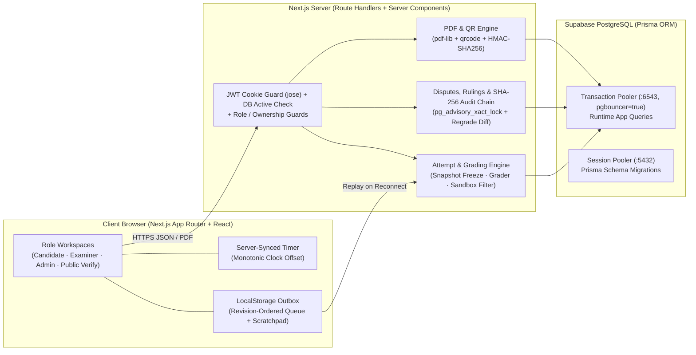
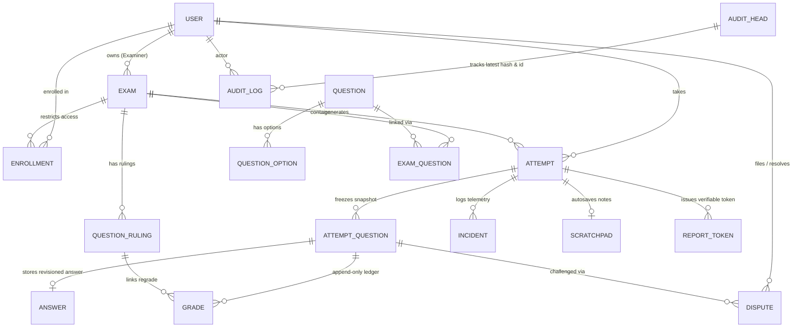
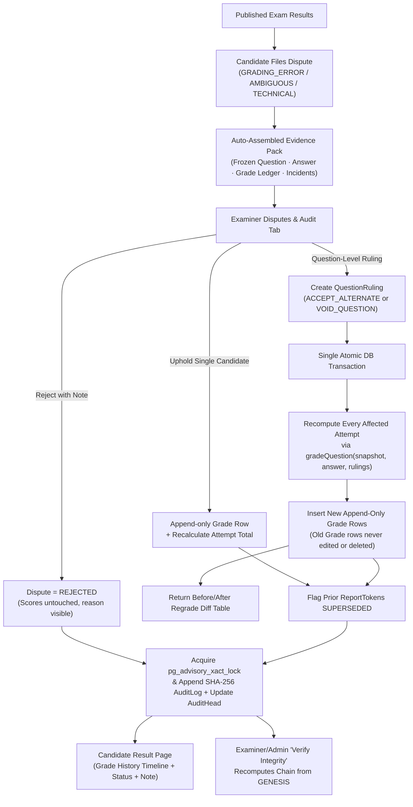
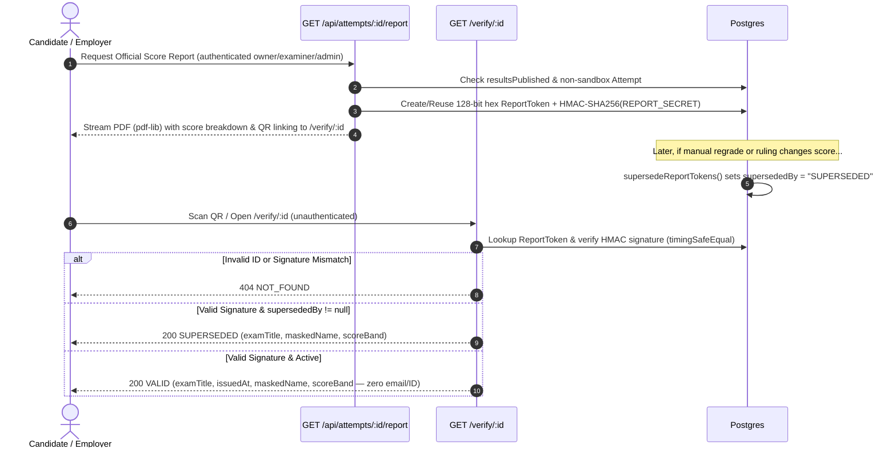

# ProctorOS

> **An examination platform where every grade can be defended.**

ProctorOS is a full-stack, verifiable online examination platform built with Next.js App Router, TypeScript, Tailwind CSS, Prisma, and PostgreSQL (Supabase). Every attempt freezes an immutable snapshot of questions and options, synchronizes timing strictly against server deadlines, buffers offline answers in a revision-ordered local outbox, generates HMAC-signed PDF score reports with public QR verification, and resolves post-exam disputes using question-level rulings backed by a SHA-256 hash-chained audit log.

---

## Table of Contents

1. [Core Features by Role](#1-core-features-by-role)
2. [System Architecture Diagrams](#2-system-architecture-diagrams)
3. [Grading & Publication Policy](#3-grading--publication-policy)
4. [Timing, Concurrency & Offline Autosave Policy](#4-timing-concurrency--offline-autosave-policy)
5. [Innovation Deep Dive: Defensible Grades & Tamper-Evident Audit](#5-innovation-deep-dive-defensible-grades--tamper-evident-audit)
6. [Setup & Environment Variables](#6-setup--environment-variables)
7. [Demo Accounts & Judge Walkthrough](#7-demo-accounts--judge-walkthrough)
8. [Verification & NPM Scripts](#8-verification--npm-scripts)
9. [Known Limitations](#9-known-limitations)

---

## 1. Core Features by Role

### Candidate Workspace
- **Enrollment-Gated Exam Dashboard:** Displays server-derived exam status (`UPCOMING`, `ONGOING`, `COMPLETED`) and candidate access status (`NOT_OPEN_YET`, `OPEN`, `IN_PROGRESS`, `SUBMITTED`, `CLOSED`).
- **Focused Assessment Workspace (`/candidate/attempts/[id]`):**
  - Server-synced countdown timer using monotonic time-offset tracking (immune to local clock changes) and urgent warnings at `< 5m` and `< 60s`.
  - **Offline-Resilient Autosave Outbox:** Queues answers (`SINGLE`, `MULTI`, `WRITTEN`, mark-for-review) in `localStorage` keyed by attempt with strict per-question monotonic `revision` numbers, live sync pill (`Saved` / `Saving...` / `Offline — queued`), and automatic replay on reconnect.
  - **Keyboard & Display Customization:** Instant `N` / `P` and `ArrowRight` / `ArrowLeft` question navigation, `390px` responsive layout, persistent font size (`SM` / `MD` / `LG`), paper theme (`Paper` / `Soft Contrast`), and question navigator side preference (`Left` / `Right`), plus a server-autosaved **Scratchpad**.
  - **Live Announcements & Neutral Event Telemetry:** Polls examiner announcements every 10s (surfaced as non-intrusive toasts and notices modal) and records neutral session telemetry (`TAB_HIDDEN`, `BLUR`, `OFFLINE`, `PASTE`) with zero automatic penalties.
- **Published Results, Grade History & Disputes (`/candidate/attempts/[id]/results`):**
  - Locked until the examiner explicitly clicks **Publish Results**.
  - Displays per-question feedback, correct options (plus alternates accepted via rulings), attempt-level **Grade History** timeline (`Original -> Current`), **Download Official PDF**, and per-question **Dispute** filing (`Grading error`, `Ambiguous question`, `Technical incident`) with automatic **Evidence Pack** attachment.

### Examiner Workspace
- **Question Bank & Bulk Import (`/examiner/questions`):** Create and manage `SINGLE`, `MULTI` (`PARTIAL_PENALTY` or `ALL_OR_NOTHING`), and `WRITTEN` questions tagged by topic and difficulty; import/export CSV & JSON batches with line-level validation errors.
- **Exam Builder & Publishing Lock (`/examiner/exams/[id]`):**
  - Configure time window, duration, total marks, negative marking, question/option shuffling, and exam question weights.
  - Pre-publish checklist verifies marks balance (`assignedMarks === totalMarks`), minimum question count, and valid window; locks marks, window, duration, and shuffling upon publishing.
  - **Preview as Candidate (Sandbox Mode):** Spawns an isolated `isSandbox = true` attempt on the live attempt engine (bypassing window/enrollment checks for the owner) with reset/restart support, excluded from all real monitor/analytics/PDF/result queries.
- **Candidate Enrollment & CSV Roster Import:** Add enrolled candidates individually or bulk import by CSV (`name,email`).
- **Live Monitor & Announcements:** 5-second polling table of real attempts showing active progress, server time remaining, and incident counts, plus live broadcast announcements.
- **Manual Grading & Controlled Publication:** Grade `WRITTEN` responses with append-only `Grade` rows and mandatory notes; publication gate blocks releasing results if written answers remain ungraded unless the examiner confirms an explicit override.
- **Results, CSV Export & PDF Reports:** Per-candidate objective/written/total breakdown, score export, and Exam Summary PDF (`/api/examiner/exams/[id]/summary-pdf`).
- **Exam & Question Analytics (`/analytics`):** Summary stats (mean, median, min/max, pass rate, average duration), score distribution histogram (Recharts), and per-question analytics highlighting `Suspect` items (`< 15%` correct or distractor chosen more often than the original key).
- **Disputes, Question Rulings & Audit Integrity (`Disputes & Audit` tab):**
  - Inspect candidate evidence packs, mark `Under Review`, **Reject** (with note), **Uphold & Regrade** (single candidate), or issue exam-wide **Question Rulings** (`ACCEPT_ALTERNATE` or `VOID_QUESTION`) with an instant **Before/After Regrade Diff Table** and **Verify Integrity** audit-chain checker.

### Administrator & Public Verification
- **User Management (`/admin`):** List users, create accounts, switch roles (`ADMIN`, `EXAMINER`, `CANDIDATE`), and deactivate/reactivate accounts (enforced immediately via DB active-user re-check on every privileged request).
- **Public Verification (`/verify/[id]` & `/api/verify/[id]`):** Unauthenticated verification page opened via PDF QR codes showing strictly minimal data: status (`VALID`, `SUPERSEDED`, or `NOT_FOUND`), exam title, issue timestamp, masked candidate name (e.g., `C*** 0***`), and score band (e.g., `80 to 90%`) — never candidate emails or internal user IDs.

---

## 2. System Architecture Diagrams

### 2.1 High-Level Application & Data Flow



---

### 2.2 Relational Data Model (Immutable Snapshots, Ledger & Audit Chain)



---

### 2.3 Attempt Lifecycle, Concurrency Guards & Offline Recovery

```mermaid
sequenceDiagram
  autonumber
  actor C as Candidate Browser
  participant API as Attempt API
  participant DB as Postgres (Prisma)

  C->>API: POST /api/attempts/start (x2 concurrent clicks)
  API->>DB: INSERT Attempt with unique realKey = examId:candidateId
  Note over DB: Winner commits with frozen AttemptQuestion snapshots;\nsecond request hits P2002 and returns existing Attempt
  DB-->>API: Single Attempt ID + serverNow + deadlineAt
  API-->>C: Return Attempt (options stripped of isCorrect)

  rect rgb(245, 245, 240)
    Note over C,API: Active Exam Session (Online & Offline)
    C->>API: PUT /answers (revision: 2)
    API->>DB: Check deadlineAt + 3s grace & UPDATE WHERE revision < 2
    DB-->>API: Saved (returns authoritative serverNow)
    Note over C: Network drops -> Outbox stores rev 3 locally
    C->>API: Reconnect -> Replay PUT /answers (revision: 3)
    API-->>C: Accepted (stale rev 1 ignored cleanly)
  end

  C->>API: POST /api/attempts/:id/submit (or timer expires)
  API->>DB: UPDATE Attempt SET status=SUBMITTED WHERE status=IN_PROGRESS
  Note over DB: Conditional transition executes autoGradeAttempt() once
  DB-->>API: Stored totalScore & status
  API-->>C: Submission receipt (scores hidden until resultsPublished=true)
```

---

### 2.4 Innovation Flow: Disputes, Question Rulings & Audit Verification



---

### 2.5 Official PDF Report & Zero-PII QR Verification



---

## 3. Grading & Publication Policy

1. **Snapshot-Only Evaluation (`src/lib/grading.ts`):** Every submitted attempt is graded exclusively against frozen `AttemptQuestion` snapshots (`textSnapshot`, `typeSnapshot`, `marksSnapshot`, `optionsSnapshot`, `multiModeSnapshot`) and active `QuestionRuling` overlays — editing a question in the bank never retroactively alters active or completed attempts.
2. **Single-Choice (`SINGLE`):** Full `marksSnapshot` for selecting the single correct option (or any option accepted by an active `ACCEPT_ALTERNATE` ruling); `-negativeMarking` (if configured `> 0`) for selecting a wrong option; `0` if unanswered.
3. **Multiple-Select (`MULTI`):**
   - `PARTIAL_PENALTY` (default): $\max\left(0,\ \frac{\text{correctSelected} - \text{wrongSelected}}{\text{totalCorrect}}\right) \times \text{marksSnapshot}$, clamped at `0` so multi-select never goes negative.
   - `ALL_OR_NOTHING`: full `marksSnapshot` only when every correct option is selected and zero wrong options are selected; otherwise `0`.
4. **Written (`WRITTEN`):** Remains `pending` upon submission until manually scored by the owning examiner (`0` to `marksSnapshot`), unless a `VOID_QUESTION` ruling applies (which awards full `marksSnapshot`).
5. **Append-Only Grade Ledger:** Auto-grades, manual grades, upheld single disputes, and question rulings always **insert** a new `Grade` row and recalculate `Attempt.totalScore` from the latest `Grade` per question. Historical `Grade` rows are never overwritten or deleted.
6. **Controlled Results Publication:** Candidates cannot view scores, answer keys, disputes, or download official PDFs while `exam.resultsPublished === false`. Publishing is gated if any real submitted attempts still contain ungraded `WRITTEN` items unless the examiner explicitly confirms override.
7. **Sandbox Isolation (`realAttemptsWhere`):** All `isSandbox = true` preview attempts are strictly excluded from grading queues, results tables, analytics, CSV exports, exam summary PDFs, disputes, and publication checks.

---

## 4. Timing, Concurrency & Offline Autosave Policy

1. **Authoritative Deadline Calculation:** On `POST /api/attempts/start`, the server sets:
   - Real attempts: $\text{deadlineAt} = \min(\text{serverNow} + \text{durationMin},\ \text{exam.endTime})$.
   - Sandbox previews: $\text{deadlineAt} = \text{serverNow} + \text{durationMin}$.
2. **Client Countdown Without Clock Trust:** The browser computes the initial clock offset between `serverNow` and `performance.now()` (re-syncing on every autosave response) so changing the OS wall clock cannot extend an attempt.
3. **Grace Window & Lazy Expiration (`3000 ms`):** `PUT /api/attempts/[id]/answers` rejects writes past `deadlineAt + 3000ms` with HTTP `409`, triggers lazy server finalization (`AUTO_SUBMITTED` + `autoGradeAttempt`), and preserves all prior saved answers.
4. **Idempotent Attempt Creation (`realKey`):** Each real attempt enforces `@unique realKey = "${examId}:${candidateId}"`. Simultaneous start clicks result in a single row (`P2002` conflict handler fetches and returns the existing attempt).
5. **Revision-Ordered Autosave:** Each answer write carries a monotonically increasing integer `revision`. Writes with `revision <= storedRevision` are cleanly ignored (`ignored: true`) so delayed out-of-order requests never overwrite newer work.
6. **Single-Transition Submit:** `POST /api/attempts/[id]/submit` executes a conditional `UPDATE ... WHERE id = ? AND status = 'IN_PROGRESS'` inside a transaction; concurrent double-submits transition at most once and return consistent stored results.

---

## 5. Innovation Deep Dive: Defensible Grades & Tamper-Evident Audit

### What & Why
Traditional exam platforms either prohibit post-exam corrections or silently overwrite question banks and database scores—destroying historical evidence and leaving affected students without recourse. ProctorOS introduces **Snapshot-Immutable Rulings + Hash-Chained Audit Proof**:
- Ambiguous questions are resolved via an overlay (`QuestionRuling`), never by mutating historical snapshots.
- Every score change appends a new `Grade` row, calculates a full **Before/After Regrade Diff Table**, invalidates outdated PDF certificates (`ReportToken.supersededBy`), and logs all privileged mutations into a cryptographic chain.

### How It Works (`src/lib/audit.ts` & `src/lib/disputes.ts`)
1. Inside the same Prisma transaction that mutates grades, publications, disputes, or rulings, `appendAuditLog(tx, ...)` acquires a transaction-scoped advisory lock:
   ```sql
   SELECT pg_advisory_xact_lock(948271635);
   ```
   This guarantees concurrent score/dispute transactions serialize around `AuditHead` (`id = 1`) and never fork the chain by reading the same `prevHash`.
2. Payloads are normalized via deterministic sorted-key JSON canonicalization (`stableAuditStringify`), hashed via:
   ```text
   hash = SHA256(prevHash | actorId | action | entity | entityId | canonicalPayload | createdAtISO)
   ```
   and chained onto the previous entry (`GENESIS` for row `#1`).
3. Clicking **Verify Integrity** (`POST /api/audit/verify`) replays every `AuditLog` entry sequentially from `GENESIS`, verifies each `prevHash` link, recomputes each digest, checks `AuditHead`, and reports either **Verified** or the **exact broken row ID** if any row was tampered with in PostgreSQL.

### Honest Trade-offs & Mitigations
- **Transaction Serialization Trade-off:** Holding a single advisory lock serializes audit writes cleanly without deadlocks and incurs negligible overhead because only privileged events (manual grades, publications, dispute actions, rulings) are logged—high-frequency candidate autosaves and focus telemetry are excluded from the audit chain.
- **Database Admin Threat Model:** Someone with full superuser write access to PostgreSQL could theoretically rewrite every row in `AuditLog` and `AuditHead` from row `#1`. In production deployments, mitigating this requires periodically anchoring `AuditHead.lastHash` externally (e.g., an append-only external bucket, Slack/webhook anchor, or WORM log sink).

---

## 6. Setup & Environment Variables

### Prerequisites
- Node.js `>= 20` and npm
- A PostgreSQL database (configured for Supabase via pooled + session connection strings)

### Environment Configuration
Copy [`.env.example`](.env.example) to `.env` and populate all five variables:

| Variable | Purpose |
| --- | --- |
| `DATABASE_URL` | Pooled PostgreSQL URL for app runtime (`?pgbouncer=true`, port `6543` on Supabase Transaction Pooler) |
| `DIRECT_URL` | Direct / IPv4 Session Pooler URL for Prisma migrations (`port 5432` on Supabase) |
| `SESSION_SECRET` | Random 64-char hex secret signing `jose` `httpOnly` session JWTs |
| `REPORT_SECRET` | Separate random 64-char hex secret signing `ReportToken` HMAC-SHA256 verification payloads |
| `NEXT_PUBLIC_APP_URL` | Base URL embedded inside QR codes (`http://localhost:3000` locally, Vercel URL in production) |

### Local Installation & Database Setup

```bash
# 1. Install exact pinned dependencies
npm install

# 2. Generate Prisma Client and apply migrations
npx prisma migrate deploy

# 3. Seed the full judge demo dataset (18 users, 30 questions, 3 exams, 4 audit entries)
npm run db:reset-demo

# 4. Run development or production server
npm run dev
# or: npm run build && npm run start
```

> **Note:** On Vercel, leave Install Command as `npm install` and Build Command as `npm run build` (`prisma generate && next build`).

---

## 7. Demo Accounts & Judge Walkthrough

Running `npm run db:reset-demo` resets the database to a verified, judge-ready demo state containing **1 Admin**, **2 Examiners**, **15 Candidates**, **30 Questions** (across `Distributed Systems`, `Database Internals`, `Concurrency Control`, and `Applied Cryptography` in `EASY`/`MEDIUM`/`HARD` difficulties), and **3 Published Exams**:

| Persona | Email | Password | Demo Highlights |
| --- | --- | --- | --- |
| **Examiner (Owner)** | `examiner1@proctoros.local` | `Examiner123!` | Live Monitor (`CS-412`), Sandbox Preview, Analytics (`Suspect` flag on Q2), Dispute Queue, Question Rulings & Audit Integrity Check |
| **Examiner (Isolation)** | `examiner2@proctoros.local` | `Examiner123!` | Separate examiner account enforcing `403` cross-examiner ownership isolation |
| **Candidate 01** | `candidate1@proctoros.local` | `Candidate123!` | `CS-401` published results, Official PDF + QR Verify, and pre-filed `OPEN` ambiguity dispute |
| **Candidate 03** | `candidate3@proctoros.local` | `Candidate123!` | Ready to start live `CS-412` exam fresh (`OPEN`), test offline outbox, scratchpad & `N`/`P` keys |
| **Administrator** | `admin@proctoros.local` | `Admin123!` | User management across all 18 accounts, role assignment & instant deactivation |

The `/login` page also provides **One-click demo persona** cards alongside standard credential authentication so evaluators can jump into any role immediately.

### Recommended Live Demo Flow
1. Sign in as **Dr. Nadia Hassan** (`examiner1@proctoros.local`) and open **`CS-412 Live Concurrency Quiz`** → **Monitor** tab to inspect the `2` active live attempts and broadcast an announcement; test **Preview as Candidate** (Sandbox mode).
2. Open **`CS-401 Systems & Database Mid-Term`** → **Analytics** tab to inspect the score histogram and the **`Suspect`** flag on the ambiguous Raft consensus question (`8×` strong distractor vs `5×` original key).
3. Switch to **Disputes & Audit** → inspect Candidate 01's **Evidence Pack** → click **Question Ruling** (`Accept Alternate Option`) → view the atomic **Before/After Regrade Diff Table** across all `15` attempts (`8` score updates) → click **Verify Integrity** on the SHA-256 audit chain.
4. Sign in as **Candidate 01** (`candidate1@proctoros.local`) to view the updated **Grade History** panel (`Original -> Current`), download the **Official PDF**, and verify the token publicly at `/verify/[id]`.
5. Run `npm run db:reset-demo` prior to presenting to restore the clean baseline (never during the demo).

---

## 8. Verification & NPM Scripts

| Script | Command | Description |
| --- | --- | --- |
| Unit Tests | `npm test` | Runs Node test runner via `tsx` across [tests/grading.test.ts](tests/grading.test.ts) and [tests/audit.test.ts](tests/audit.test.ts) |
| Integrity Suite | `npm run integrity-check` | Runs [scripts/integrity-check.ts](scripts/integrity-check.ts) (`npx tsx scripts/integrity-check.ts [BASE_URL]`) verifying `401/403` guards, concurrent `start`, zero answer leaks, frozen snapshots, stale revision rejection, triple concurrent `submit`, and post-grace (`+3s`) late-save rejection |
| Demo Reset | `npm run db:reset-demo` | Clears non-user demo tables, seeds 18 users / 30 questions / 3 exams, and verifies the `AuditLog` hash chain |
| Safe Seed | `npm run db:seed` | Upserts users and seeds demo exams/questions only if not already present |
| Typecheck | `npm run typecheck` | Runs `tsc --noEmit` |
| Lint | `npm run lint` | Runs `eslint` |
| Build | `npm run build` | Runs `prisma generate && next build` |

---

## 9. Known Limitations

- **External Audit Anchoring:** `AuditHead.lastHash` is stored in the same PostgreSQL database (`AuditHead` table). While tampering with individual historical rows is detected immediately by **Verify Integrity**, an attacker with direct superuser DB credentials could rewrite the entire chain from `GENESIS`; anchoring `AuditHead.lastHash` to an external immutable store is a future hardening step.
- **Polling vs WebSockets:** Monitor updates (`5s`) and candidate announcements (`10s`) use HTTP polling so the application remains stateless across serverless Next.js functions with zero persistent WebSocket broker dependencies.
- **Exam Blueprint Fairness (P2 Stretch):** Automated randomized blueprint sampling per difficulty/topic per attempt is intentionally out of scope so every candidate in an exam receives a consistent, auditable set of frozen questions (with optional per-attempt question/option order shuffling).
- **PDF Font Encoding:** `pdf-lib` uses standard WinAnsi PDF fonts (`Helvetica`, `Courier`); unsupported non-WinAnsi Unicode glyphs in question text are sanitized cleanly via `safePdfText` before PDF generation so reports never crash.
