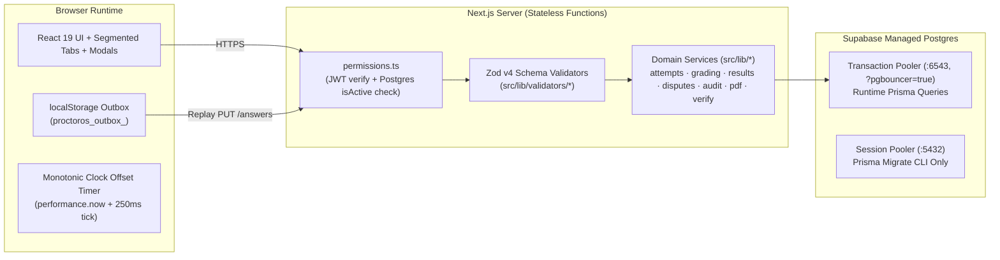
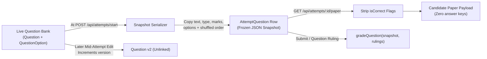
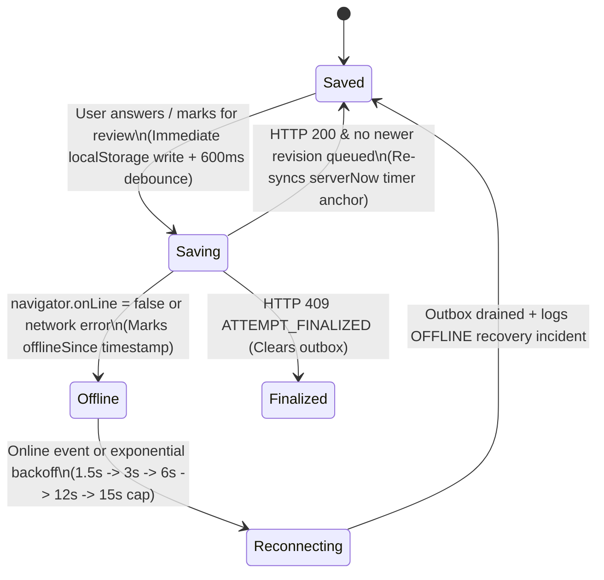

# ProctorOS — Technical Architecture & Engineering Techniques Reference

This document details every architectural pattern, concurrency primitive, cryptographic guarantee, client-resilience mechanism, data-isolation invariant, and UI engineering technique implemented inside **ProctorOS**.

---

## Table of Contents

1. [System Topology & Cloud Database Strategy](#1-system-topology--cloud-database-strategy)
2. [Authentication, Session Security & Authorization Guards](#2-authentication-session-security--authorization-guards)
3. [Immutable Snapshots & Answer-Key Leakage Prevention](#3-immutable-snapshots--answer-key-leakage-prevention)
4. [Concurrency Control & Idempotency Primitives](#4-concurrency-control--idempotency-primitives)
5. [Server-Authoritative Timing & Derived Lifecycle State](#5-server-authoritative-timing--derived-lifecycle-state)
6. [Offline-Resilient Client Autosave Outbox](#6-offline-resilient-client-autosave-outbox)
7. [Deterministic Grading Engine & Append-Only Grade Ledger](#7-deterministic-grading-engine--append-only-grade-ledger)
8. [Dispute Resolution, Evidence Packs & Atomic Bulk Regrades](#8-dispute-resolution-evidence-packs--atomic-bulk-regrades)
9. [Tamper-Evident SHA-256 Hash-Chained Audit Log](#9-tamper-evident-sha-256-hash-chained-audit-log)
10. [Verifiable PDF Generation & Zero-PII QR Verification](#10-verifiable-pdf-generation--zero-pii-qr-verification)
11. [Analytics, Suspect-Question Heuristics & Neutral Telemetry](#11-analytics-suspect-question-heuristics--neutral-telemetry)
12. [Sandbox Isolation & Resilient Bulk CSV/JSON Importer](#12-sandbox-isolation--resilient-bulk-csvjson-importer)
13. [Editorial Design System, Motion Craft & Accessibility](#13-editorial-design-system-motion-craft--accessibility)
14. [Testing, Integrity Verification & Demo Data Lifecycle](#14-testing-integrity-verification--demo-data-lifecycle)

---

## 1. System Topology & Cloud Database Strategy

ProctorOS uses **Next.js 16 (App Router + Turbopack)** with **React 19** Server Components for initial page hydration and Route Handlers (`/api/**`) for mutations, paired with **PostgreSQL (Supabase)** via **Prisma ORM (`6.19.3`)**.

### Key Runtime Techniques
- **Dual Connection String Split ([`schema.prisma`](../prisma/schema.prisma)):**
  - `DATABASE_URL` routes all serverless queries through Supabase's **Transaction Pooler (`:6543/?pgbouncer=true`)** to avoid exhausting Postgres backend connections across serverless function instances.
  - `DIRECT_URL` targets the **IPv4-compatible Session Pooler (`:5432`)** exclusively for `prisma migrate` DDL operations.
- **Prisma Singleton (`src/lib/db.ts`):** Attaches the `PrismaClient` instance to `globalThis` in non-production environments to prevent connection exhaustion across HMR reloads.
- **Build & Codegen Safety ([`package.json`](../package.json)):** `npm run build` runs `prisma generate && next build` explicitly so Prisma Client types always match the deployed schema without fragile `postinstall` hooks.
- **Transaction Timeout Tuning for Remote Postgres RTT:** Interactive `db.$transaction(..., { maxWait: 15000, timeout: 30000–45000 })` budgets combined with `createMany` / `updateMany` batching prevent Prisma's default `5000ms` interactive transaction timeout from tripping under multi-candidate regrades across remote cloud regions.

---

## 2. Authentication, Session Security & Authorization Guards

ProctorOS intentionally implements self-contained session authentication rather than delegating session management to an external auth SDK so every authorization boundary is explicit, unit-inspectable, and independent of RLS policy drift.

### Techniques Implemented
1. **Password Hashing (`src/lib/auth.ts`):** Uses `bcryptjs` (`10` salt rounds) for per-user salted hashes. Every user projection uses `SAFE_USER_SELECT`, explicitly omitting `passwordHash`. Public self-registration (`/api/auth/register`) is disabled (`403`); administrators provision accounts.
2. **HS256 Session JWT (`src/lib/session.ts`):**
   - Signed with `jose` (`SignJWT` / `jwtVerify`) using `SESSION_SECRET`.
   - Stored in an `HttpOnly`, `SameSite=Lax` cookie (`proctoros_session`) with a `24`-hour TTL (`SESSION_MAX_AGE_SECONDS = 86400`).
3. **Zero-Trust Active-User Re-Check (`src/lib/permissions.ts`):**
   - `getActiveSessionUser()` verifies the JWT signature and then queries `db.user.findUnique` (`id`, `role`, `isActive`).
   - If an administrator deactivates an account (`isActive = false`), **existing valid JWT cookies lose API access (`401`) on the very next request** without requiring a token blocklist.
4. **Composable Resource Ownership Guards (`src/lib/permissions.ts`):**
   - `requireRole(allowedRoles)` → enforces `401` (unauthenticated/inactive) vs `403` (insufficient role).
   - `requireExamOwner(examId)` → restricts exam edits, grading, publication, monitor, analytics, summary PDF, disputes, and rulings to the owning `EXAMINER` or `ADMIN`.
   - `requireQuestionOwner(questionId)` → enforces ownership on question bank edits/deletions.
   - `requireEnrollment(examId)` → restricts starting attempts to enrolled `CANDIDATE`s.
   - `requireAttemptOwner(attemptId)` → ensures only the attempt's owner (candidate, or examiner owner for sandbox previews) can fetch papers, save answers, file disputes, or view candidate results.
   - `requireAttemptViewer(attemptId)` → permits PDF report downloads strictly for the candidate owner, parent exam owner, or `ADMIN`, rejecting sandbox attempts (`404`) and cross-candidate requests (`403`).

---

## 3. Immutable Snapshots & Answer-Key Leakage Prevention

### Key Techniques
1. **Start-Time Deep Freeze (`src/lib/attempts.ts`):** When `startOrResumeAttempt` creates an `Attempt`, every `ExamQuestion` is copied into an `AttemptQuestion` row containing `sourceQuestionId`, `textSnapshot`, `typeSnapshot`, `marksSnapshot` (`marksOverride ?? question.marks`), `optionsSnapshot` (`Json`), and `multiModeSnapshot`.
2. **Optional Deterministic-Per-Attempt Shuffling:** If `exam.shuffleQuestions` or `exam.shuffleOptions` is enabled, Fisher-Yates shuffling executes *once* at snapshot creation and freezes the exact order inside `AttemptQuestion.position` and `optionsSnapshot`, ensuring page refreshes preserve the exact layout the candidate saw.
3. **Mid-Attempt Isolation:** Editing a bank question increments `Question.version` and updates future exams, while active and completed `AttemptQuestion` snapshots remain untouched.
4. **Strict Candidate Projection Stripping:**
   - `getAttemptPaper()` explicitly strips `isCorrect` from `optionsSnapshot` before returning JSON to the client.
   - `getCandidateAttemptResult()` gates correct-answer and score visibility behind `if (!attempt.exam.resultsPublished)`—returning only submission metadata prior to release.

---

## 4. Concurrency Control & Idempotency Primitives

Every race-prone user flow is protected by database-enforced invariants rather than client button disabling alone:

| Race Condition | Guard / Primitive | Implementation File |
| --- | --- | --- |
| **Double-click "Start Exam"** | Unique nullable column `realKey = "${examId}:${candidateId}"` (set to `null` for `isSandbox = true`). Concurrent inserts hit PostgreSQL unique violation (`P2002`), caught to return the winning `Attempt` row. | [`src/lib/attempts.ts`](../src/lib/attempts.ts) |
| **Out-of-order / stale autosave** | Monotonic integer `revision` per `AttemptQuestion`. Inside a transaction, writes with `incomingRevision <= existing.revision` return `{ ok: true, ignored: true }` without mutating stored data. | [`src/lib/attempts.ts`](../src/lib/attempts.ts) |
| **Double / triple concurrent Submit** | Conditional atomic transition `UPDATE "Attempt" SET status='SUBMITTED' WHERE id=? AND status='IN_PROGRESS'`. Only `count === 1` triggers `autoGradeAttempt(tx, id)`; losing calls read and return the committed state. | [`src/lib/attempts.ts`](../src/lib/attempts.ts) |
| **Audit-chain fork on simultaneous writes** | Transaction-scoped advisory lock `SELECT pg_advisory_xact_lock(948271635)` serializes `AuditHead` reads + `AuditLog` inserts cleanly and auto-releases at commit/rollback. | [`src/lib/audit.ts`](../src/lib/audit.ts) |
| **In-flight client queue race** | After `PUT /answers` succeeds, client removes the item from `localStorage` outbox **only if** `outbox.answers[qId].revision <= sentRevision` so rapid concurrent edits are never discarded. | [`src/hooks/use-attempt-autosave.ts`](../src/hooks/use-attempt-autosave.ts) |

---

## 5. Server-Authoritative Timing & Derived Lifecycle State

### Lifecycle Derivation (`src/lib/time.ts`)
- Stored database `Exam.status` only tracks `DRAFT` vs `PUBLISHED`.
- `getExamStatus(exam, serverNow)` derives `DRAFT`, `UPCOMING` (`now < startTime`), `ONGOING` (`startTime <= now <= endTime`), and `COMPLETED` (`now > endTime`) strictly on the server so client clock manipulation cannot spoof availability.
- `evaluatePublishChecklist()` verifies non-zero question count, exact marks balance (`|assignedMarks - totalMarks| < 0.001`), and `durationMin <= floor((endTime - startTime) / 60000)`.

### Deadline Calculation & Drift-Free Countdown
- **Attempt Deadline (`src/lib/attempts.ts`):**
  $$\text{deadlineAt} = \min(\text{serverNow} + \text{durationMin} \times 60{,}000,\ \text{exam.endTime})$$
  *(For Sandbox previews, $\text{deadlineAt} = \text{serverNow} + \text{durationMin} \times 60{,}000$ regardless of exam window.)*
- **Monotonic Offset Display (`src/hooks/use-server-timer.ts`):**
  - Anchors remaining time at `{ serverMs, perfMs: performance.now() }`.
  - Computes `estimatedServerNow = anchor.serverMs + (performance.now() - anchor.perfMs)` every `250ms` (`performance.now()` is monotonic relative to page load and unaffected by OS clock adjustments).
  - Every `PUT /answers` response returns fresh `serverNow` to continuously recalibrate the anchor via `syncServerClock()`.
- **Grace Window & Lazy Expiration (`LATE_SAVE_GRACE_MS = 3000`):**
  - `saveAttemptAnswer` evaluates `finalizeIfExpired(attemptId, true)`, permitting `3s` of network transit slack past `deadlineAt`.
  - Any write past `deadlineAt + 3000ms` transitions the attempt to `AUTO_SUBMITTED`, runs `autoGradeAttempt`, and rejects the stale write with `HTTP 409` (`ATTEMPT_FINALIZED`).
  - `finalizeExpired(examId)` sweeps overdue `IN_PROGRESS` real attempts lazily whenever Monitor, Grading/Results, or Analytics loads—requiring zero background cron infrastructure.

---

## 6. Offline-Resilient Client Autosave Outbox

### Implementation Details ([`src/hooks/use-attempt-autosave.ts`](../src/hooks/use-attempt-autosave.ts))
- **Synchronous Persistence:** Every keystroke, radio click, or review toggle writes immediately to `localStorage` under `proctoros_outbox_${attemptId}` before starting the `fetch` timer.
- **Mount Recovery:** On hard page refresh or tab reopen, `useAttemptAutosave` hydrates unsent revisions into React state (`onRecoverOutbox`) whenever `queued.revision > serverRevision` and immediately triggers `flushOutbox()`.
- **Scratchpad Dual Sync:** Scratchpad notes are cached alongside answers (`scratchpad.dirty`) and synced via `PUT /api/attempts/[id]/scratchpad` under the same `ATTEMPT_FINALIZED` guard.
- **Exponential Backoff:** Retries follow `Math.min(15000, 1500 * Math.pow(2, backoffAttempt))` without spamming failing endpoints while disconnected, and records a single `OFFLINE` telemetry event containing outage duration upon successful reconnection.

---

## 7. Deterministic Grading Engine & Append-Only Grade Ledger

### Pure Snapshot + Ruling Grader (`src/lib/grading.ts`)
`gradeQuestion(snapshot, answer, rulings, negativeMarking)` is deterministic and side-effect-free (verified directly by unit tests in [`tests/grading.test.ts`](../tests/grading.test.ts)):

1. **Ruling Precedence:**
   - If any active `QuestionRuling` on `sourceQuestionId` has `type === "VOID_QUESTION"`, return `{ score: marksSnapshot, pending: false, rulingId }`.
   - For `ACCEPT_ALTERNATE`, aggregate all `acceptedOptionIds` across rulings for that question into the valid option set alongside original `isCorrect` options.
2. **Question Type Scoring:**
   - **`WRITTEN`:** Returns `{ score: null, pending: true }` until manually graded (unless voided).
   - **`SINGLE`:** Full `marksSnapshot` if `selected.length === 1 && correctIds.has(selected[0])`; `0` if unanswered; `-roundScore(negativeMarking)` if incorrect and `negativeMarking > 0`.
   - **`MULTI` (`ALL_OR_NOTHING`):** `marksSnapshot` only when `correctSelected === correctIds.size && wrongSelected === 0`, else `0`.
   - **`MULTI` (`PARTIAL_PENALTY`):**
     $$\text{score} = \text{round}_2\!\left(\max\!\left(0,\ \frac{\text{correctSelected} - \text{wrongSelected}}{\max(1,\ |\text{correctIds}|)}\right) \times \text{marksSnapshot}\right)$$
3. **Append-Only Ledger & Grade History (`src/lib/results.ts`):**
   - `Grade` rows are **never updated or deleted**. The active grade for an `AttemptQuestion` is always `grades[0]` ordered by `createdAt DESC`.
   - `getCandidateAttemptResult()` reconstructs chronological attempt-level deltas from earliest baseline grades forward (`scoreChangeHistory`: `originalTotal`, `currentTotal`, and ordered `events[]` with `previousTotal`, `newTotal`, `delta`, `reason`, `rulingId`).

---

## 8. Dispute Resolution, Evidence Packs & Atomic Bulk Regrades

Implemented in [`src/lib/disputes.ts`](../src/lib/disputes.ts) and [`src/lib/validators/dispute.ts`](../src/lib/validators/dispute.ts):

- **Post-Publication Candidate Disputes:** Candidates can file one active (`OPEN` / `UNDER_REVIEW`) dispute per `AttemptQuestion` (`AMBIGUOUS`, `GRADING_ERROR`, `TECHNICAL`) only after `exam.resultsPublished === true`. Cross-candidate reads return `403`.
- **Immutable Evidence Pack:** Automatically assembles:
  - Frozen question prompt, marks, and options snapshot
  - Recorded answer (`selectedOptionIds` / `writtenText`, `revision`, `savedAt`)
  - Awarded marks and full append-only question `Grade` ledger
  - Attempt session timestamps (`startedAt`, `submittedAt`, `deadlineAt`) and all recorded `Incident` events
- **Examiner Queue Decisions (`resolveExaminerDispute`):**
  - `UNDER_REVIEW` / `REJECT` (mandatory reason; scores untouched; logged to audit chain)
  - `UPHOLD` (single-candidate manual score adjustment: inserts new `Grade` row, recalculates `Attempt.totalScore`, supersedes `ReportToken`s, logs `DISPUTE_UPHELD_REGRADE`)
- **Exam-Wide Question Rulings (`applyQuestionRuling`):**
  - Creates a `QuestionRuling` (`ACCEPT_ALTERNATE` or `VOID_QUESTION`) without modifying snapshots.
  - Inside one atomic transaction (`timeout: 45000`), recomputes every finalized real `AttemptQuestion` matching `sourceQuestionId`, batch-inserts new `Grade` rows via `createMany`, updates each affected `Attempt.totalScore`, batch-supersedes `ReportToken`s for changed attempts, marks targeted/impacted open disputes `UPHELD`, logs `QUESTION_RULING_APPLIED` with all candidate deltas, and returns the sorted **Before/After Regrade Diff Table** (`oldQuestionScore`, `newQuestionScore`, `oldTotalScore`, `newTotalScore`, `delta`).

---

## 9. Tamper-Evident SHA-256 Hash-Chained Audit Log

Implemented in [`src/lib/audit.ts`](../src/lib/audit.ts) and tested in [`tests/audit.test.ts`](../tests/audit.test.ts):

### Chain Construction & Deterministic Hashing
1. **JSONB Key-Order Normalization:** PostgreSQL `JSONB` does not guarantee preservation of object key insertion order across writes and reads. `stableAuditStringify()` recursively sorts object keys and strips `undefined` values after JSON cloning so hash computation is 100% invariant across Postgres round-trips.
2. **Digest Formula:**
   $$\text{hash}_n = \text{SHA256}\!\left(\text{prevHash}_n\ \|\ \text{actorId}_n\ \|\ \text{action}_n\ \|\ \text{entity}_n\ \|\ \text{entityId}_n\ \|\ \text{canonicalPayload}_n\ \|\ \text{createdAtISO}_n\right)$$
   where $\text{prevHash}_1 = \text{"GENESIS"}$.
3. **Advisory Serialization (`appendAuditLog`):**
   - Executes `SELECT pg_advisory_xact_lock(948271635)` inside the caller's Prisma transaction.
   - Reads/initializes singleton `AuditHead` (`id = 1`), writes `AuditLog` with explicit millisecond-precision `createdAt`, and updates `AuditHead` (`lastHash`, `lastId`).
   - Logged actions are scoped strictly to privileged/score-changing mutations: `RESULTS_PUBLISHED`, `MANUAL_GRADE`, `DISPUTE_FILED`, `DISPUTE_UNDER_REVIEW`, `DISPUTE_REJECTED`, `DISPUTE_UPHELD_REGRADE`, `QUESTION_RULING_APPLIED`.
4. **Sequential Verification (`verifyAuditChain` via `POST /api/audit/verify`):**
   - Reads every `AuditLog` row ordered by `id ASC` and compares `AuditHead`.
   - Detects any link mismatch (`prevHash !== expectedPrev`), row modification (`hash !== recomputed`), or head pointer mismatch, returning `{ ok: false, brokenRow: { id, action, entity, entityId, reason } }` naming the first compromised row.

---

## 10. Verifiable PDF Generation & Zero-PII QR Verification

Implemented in [`src/lib/pdf.ts`](../src/lib/pdf.ts) and [`src/lib/verify.ts`](../src/lib/verify.ts):

1. **Report Tokens & Constant-Time Signatures:**
   - Each token ID is generated via `crypto.randomBytes(16).toString("hex")` (128-bit unguessable hex string—preventing certificate enumeration).
   - Signed with `HMAC-SHA256(REPORT_SECRET)` over `${tokenId}:${attemptId}:${scoreAtIssue.toFixed(2)}:${issuedAtIso}` and verified using `crypto.timingSafeEqual` to eliminate timing side channels.
   - **Automatic Reuse & Supersession:** `issueOrGetReportToken` reuses an active token only if `scoreAtIssue` still matches the attempt's current total; otherwise (and eagerly inside `saveManualGrade`, `resolveExaminerDispute`, and `applyQuestionRuling`), prior active tokens are flagged `supersededBy = "SUPERSEDED"`.
2. **PDF Rendering (`pdf-lib` + `qrcode`):**
   - **WinAnsi Font Safety:** `pdf-lib` standard PDF fonts (`Helvetica`, `HelveticaBold`, `Courier`) support WinAnsi encoding only. `safePdfText()` sanitizes/normalizes Unicode punctuation and strips non-WinAnsi characters so unexpected question symbols never crash PDF generation.
   - **Candidate Official Result PDF (`GET /api/attempts/[id]/report`):** Renders exam title, candidate name, score, percentage, per-topic performance breakdown, issue date, token ID, and an embedded `qrcode` PNG linking directly to `${NEXT_PUBLIC_APP_URL}/verify/${token.id}`.
   - **Examiner Summary PDF (`GET /api/examiner/exams/[id]/summary-pdf`):** Examiner/Admin-only cohort report excluding sandbox attempts.
3. **Minimal-Exposure Public Verify Endpoint (`/verify/[id]` & `/api/verify/[id]`):**
   - Returns HTTP `404` `{ status: "NOT_FOUND" }` if missing or HMAC verification fails.
   - Returns HTTP `200` with strictly non-PII fields: `status` (`"VALID"` or `"SUPERSEDED"`), `examTitle`, `issuedAt`, `scoreBand` (10%-bucketed range, e.g. `"80 to 90%"`), and `maskedName` (first character per token + `***`, e.g. `"C*** 0***"`). Emails and user IDs are never selected or serialized.

---

## 11. Analytics, Suspect-Question Heuristics & Neutral Telemetry

### Cohort & Question Analytics (`src/lib/analytics.ts`)
- **Summary Metrics:** Mean, median (`computeMedian`), minimum, maximum, pass rate (`>= 50%`), average completion duration (minutes), and 5-bin score distribution histogram (`0–20%` through `80–100%`).
- **Ruling-Aware Recomputation:** Analytics respect active `QuestionRuling`s (`VOID_QUESTION`, `ACCEPT_ALTERNATE`) dynamically when computing per-question correctness and distractor counts.
- **Difficulty Calibration:** Classifies `observedDifficulty` (`>= 70%` → `EASY`, `>= 35%` → `MEDIUM`, `< 35%` → `HARD`) alongside `statedDifficulty`.
- **Automated Suspect Question Flags (`isSuspect`):**
  1. `correctPercent < 15%`
  2. `topWrongDistractor.count > fullMarksCount` (flags misleading or ambiguous distractors chosen more often than the keyed answer)

### Monitoring & Neutral Telemetry (`src/lib/monitor.ts`, `src/components/candidate/attempt-workspace.tsx`)
- **Examiner Monitor:** 5-second polling table displaying `answeredCount / totalQuestions`, server `remainingSeconds`, `lastActivityAt`, and expandable `Incident` details (`TAB_HIDDEN`, `BLUR`, `OFFLINE`, `PASTE`, `FULLSCREEN_EXIT`).
- **Neutral Policy:** Telemetry triggers browser listeners (`visibilitychange`, window `blur`, outbox recovery) strictly as informational indicators for examiners and dispute evidence packs—never applying automatic score penalties or lockouts.

---

## 12. Sandbox Isolation & Resilient Bulk CSV/JSON Importer

### Examination Sandbox (`src/lib/sandbox.ts`)
- Allows the exam owner (`EXAMINER` or `ADMIN`) to launch a preview attempt (`POST /api/examiner/exams/[id]/sandbox`) bypassing enrollment and window restrictions using the exact production snapshot & autosave engine (`isSandbox = true`, `realKey = null`).
- Displays a clear banner (*"Sandbox mode. Nothing is saved to real results."*) with **Reset & Restart** (`DELETE /api/examiner/exams/[id]/sandbox`).
- Every real query (`getExamMonitorState`, `getExaminerGradingAndResults`, `getExamAnalytics`, `getExaminerDisputesAndRulings`, `buildExamSummaryPdf`, `requireAttemptViewer`, `issueOrGetReportToken`) enforces the shared `realAttemptsWhere()` filter (`isSandbox: false`).

### Bulk Question & Roster Importer (`src/lib/importer.ts`)
- Uses `PapaParse` with case-insensitive header normalization (`normalizeHeader`: trims whitespace, strips `_`/`-`/spaces).
- Supports both pipe-delimited options (`options: "A|B|C|D"`) and indexed option columns (`option1`–`option5` or `a`–`e`), plus numeric (`1,3`) or text-matched `correct` specifications and JSON array imports.
- Validates every row through Zod schemas (`questionInputSchema`, `candidateImportRowSchema`), importing valid rows cleanly while returning structured `{ imported, failed: [{ row, field, message }] }` diagnostics for malformed lines.

---

## 13. Editorial Design System, Motion Craft & Accessibility

Defined in [`src/app/globals.css`](../src/app/globals.css), [`src/app/layout.tsx`](../src/app/layout.tsx), and [`src/components/ui/`](../src/components/ui):

- **60 / 30 / 10 Flat Color Palette (Zero Gradients):**
  - **Canvas (60%):** Warm Paper `#FAF9F4` (`--bg-canvas`) with `#F2F0E8` (`--bg-subtle`)
  - **Surfaces (30%):** Pure White `#FFFFFF` (`--bg-surface`) delimited by hairline `1px` borders (`#E5E5DF` / `#CFCFC6`)
  - **Ink & Accents (10%):** Deep Forest Slate `#1F2922`, Muted Olive `#5C665F`, Botanical Pine `#3A5A40` (primary/success), and Terracotta `#AE4F2F` (alerts/negative states)
- **Typography Pairing:** `Plus Jakarta Sans` (UI copy), `Newsreader` (editorial headings & display titles), and `JetBrains Mono` with `tabular-nums` (timers, hashes, scores, counts).
- **Motion Discipline:**
  - Dedicated easing tokens (`--ease-out: cubic-bezier(0.23, 1, 0.32, 1)`, `--ease-drawer: cubic-bezier(0.32, 0.72, 0, 1)`) and crisp `150ms–240ms` transitions for tactile `.pressable` feedback, modals, and drawers.
  - **Zero animation during exam question transitions:** Switching questions inside `AttemptWorkspace` updates instantly so keyboard/mouse speed is never throttled.
  - Honors `@media (prefers-reduced-motion: reduce)` across all motion utilities.
- **Accessibility & Responsive Layout:**
  - Visible focus rings (`.focus-ring`), semantic `aria-label`s, icon+label pairing (never color-only question status), keyboard navigation (`N` / `P` / `ArrowLeft` / `ArrowRight` guarded against active `INPUT`/`TEXTAREA` focus), and compact `390px` mobile header adaptation.

---

## 14. Testing, Integrity Verification & Demo Data Lifecycle

### Layered Verification Strategy
1. **Unit Tests (`npm test`):** Pure deterministic specs covering `MULTI` partial/all-or-nothing, `SINGLE` negative marking, `WRITTEN` pending/voiding, `ACCEPT_ALTERNATE` overlay scoring ([`tests/grading.test.ts`](../tests/grading.test.ts)), and canonical JSON key-order invariance + SHA-256 tamper detection ([`tests/audit.test.ts`](../tests/audit.test.ts)).
2. **Adversarial HTTP Integrity Suite (`scripts/integrity-check.ts`):** Runnable against localhost or Vercel production URLs (`npx tsx scripts/integrity-check.ts [BASE_URL]`):
   - Verifies `/api/health`, unauthenticated `401`, wrong-role `403`, cross-examiner `403`, and non-enrolled `403`.
   - Fires concurrent duplicate `POST /start` requests and asserts a single `Attempt` ID.
   - Scans paper responses to verify zero `isCorrect` and `passwordHash` leakage.
   - Mutates the source question mid-attempt and verifies active frozen snapshots remain untouched.
   - Sends `revision: 2` then stale `revision: 1` and verifies stale-write rejection.
   - Fires triple concurrent `POST /submit` requests and confirms single atomic transition.
   - Waits past `deadlineAt + 3s` grace window and asserts late autosave returns `409` and triggers server auto-submission.
3. **Deterministic Demo Seeding (`src/lib/demo-seed.ts`, `scripts/reset-demo-data.ts`):**
   - `npm run db:reset-demo` wipes mutable demo tables, creates `1` Admin, `2` Examiners, `15` Candidates, `30` Questions across `4` topics and `3` difficulties (including a deliberately ambiguous Raft consensus question with an `8×` strong distractor), `3` exams (`CS-401` completed + 15 graded attempts + disputes + `ReportToken`s, `CS-412` ongoing + 2 active attempts, `CS-499` upcoming), writes initial `AuditLog` entries inside a hash-chained transaction, and immediately runs `verifyAuditChain()` to confirm `GENESIS` integrity.
